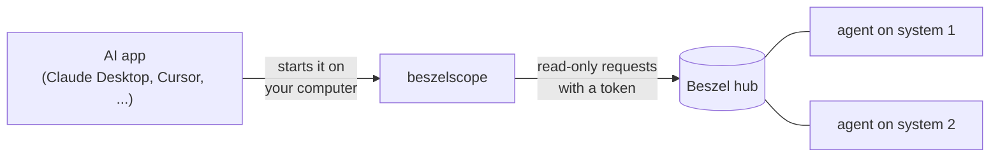

# beszelscope <!-- omit from toc -->

beszelscope is a read-only MCP server for [Beszel](https://beszel.dev), a lightweight platform for monitoring your systems. It lets AI assistants check system health, live metrics and trends.

[](https://www.aihonestybadge.com)
[](LICENSE)
[](https://github.com/agrmohit/beszelscope/releases/latest)
[](#install)

## Requirements <!-- omit from toc -->

- **A Beszel hub** that you can administer
- **An AI app that runs local MCP servers.** Most local AI harnesses can use it. Web based ones that expect http or sse cannot (claude.ai, chatgpt on web, mobile apps)

## Table of Contents <!-- omit from toc -->

- [What you can ask](#what-you-can-ask)
- [How it works](#how-it-works)
- [Install](#install)
- [Connect it to your hub](#connect-it-to-your-hub)
- [Add it to your AI app](#add-it-to-your-ai-app)
- [Configuration](#configuration)
- [Tools](#tools)
- [Limits](#limits)
- [Beszel version](#beszel-version)
- [Development](#development)

## What you can ask

Ask in plain words; the assistant picks the right tool. For example:

> **You:** How are my systems doing?
>
> **Assistant:** Two of your three systems are up. The laptop has been down for 2 days and 11 hours, and the backup storage pool on web-1 is degraded.

Behind that answer, the assistant called `fleet_status` and got back this (shortened):

```json
{
  "as_of": "2026-10-30T22:42:22Z",
  "counts": { "total": 3, "up": 2, "down": 1, "with_problems": 2 },
  "systems": [
    {
      "name": "laptop",
      "status": "down",
      "last_seen_ago_s": 212538,
      "problems": [{ "code": "status_down", "detail": "down for 2d 11h", "section": "summary" }]
    },
    {
      "name": "web-1",
      "status": "up",
      "cpu_pct": 7,
      "mem_pct": 66.8,
      "disk_pct": 40.1,
      "problems": [{ "code": "pool_degraded", "detail": "backup DEGRADED", "section": "disk" }]
    }
  ]
}
```

More questions it can answer:

- "Which containers use the most memory on web-1?"
- "Did CPU on web-1 spike in the last 24 hours?"
- "Is the SSD on my laptop healthy?"
- "When does the certificate on my monitored site expire?"
- "Which system went down, and since when?"

## How it works



Your AI app starts beszelscope in the background and talks to it directly. beszelscope reads from your Beszel hub with a token for a dedicated read-only user. It never writes to the hub.

## Install

**Download.** Each [release](https://github.com/agrmohit/beszelscope/releases) has one binary per platform, built by GitHub Actions from the tagged commit, with a build provenance attestation and a `checksums.txt`. The platforms are `darwin_arm64` (Apple silicon), `linux_arm64`, `linux_amd64`, `windows_arm64` and `windows_amd64`.

1. Download yours and check where it came from, here with the [GitHub CLI](https://cli.github.com). `gh attestation verify` proves the file was built by this repo's release workflow:

   ```sh
   gh release download -R agrmohit/beszelscope -p '*_<platform>*'
   gh attestation verify <file> -R agrmohit/beszelscope --signer-workflow agrmohit/beszelscope/.github/workflows/release.yml
   ```

   Or download it from the release page and compare its SHA-256 with its line in `checksums.txt`.

2. Rename it to `beszelscope` (keep the `.exe` on Windows) and move it to a folder on your `PATH`. On macOS and Linux, make it executable with `chmod +x beszelscope`.
3. The binaries are not code signed, so a copy downloaded with a browser is flagged on first run. Clear the flag with `xattr -d com.apple.quarantine <file>` on macOS, or `Unblock-File <file>` in PowerShell on Windows. Copies fetched with `gh` or `curl` are not flagged.

**With Go** (1.27 or later). This installs into `$(go env GOPATH)/bin`:

```sh
go install github.com/agrmohit/beszelscope/cmd/beszelscope@latest
```

**From source**, on macOS and Linux. This installs into `~/.local/bin`:

```sh
git clone https://github.com/agrmohit/beszelscope
cd beszelscope
make install
```

Check that it runs:

```sh
beszelscope version
```

## Connect it to your hub

beszelscope signs in as its own Beszel user with the `readonly` role, using a long-lived token. Password login can stay switched off on your hub.

1. **Create the user.** As a superuser, open your hub's admin panel at `/_/`, go to the `users` collection and add a user (for example `beszelscope@example.com`) with the role `readonly`.
2. **Share your systems.** Beszel shows a user only the systems they are listed on. In `/_/`, open the `systems` collection and add the new user to each system's `users`. Do the same for every system you add later.
3. **Create a token.** In `/_/`, open the new user, choose **Impersonate** from its menu, set the duration in seconds (`315360000` is 10 years) and copy the token. These tokens cannot be refreshed; beszelscope warns when fewer than 30 days are left.
4. **Store the token.**

   - On **macOS**, save it in your Keychain. Piping it in avoids typing errors:

     ```sh
     pbpaste | BESZELSCOPE_URL=https://beszel.example.com beszelscope token set
     ```

     `token set` checks the token, asks the hub whether it works, and stores it. A failed hub check only warns.

   - On **Linux** and **Windows**, put it in the `BESZELSCOPE_TOKEN` environment variable instead (see [Add it to your AI app](#add-it-to-your-ai-app)).

**Renewing.** Create a new token (step 3) and store it again.

**Revoking.** Change the user's password in `/_/`. That resets the user's token key, so every token for the user stops working.

## Add it to your AI app

Most apps take a JSON entry like this one. Use the full path to the binary, because apps often start MCP servers without your shell's `PATH`:

```json
{
  "mcpServers": {
    "beszelscope": {
      "command": "/Users/you/.local/bin/beszelscope",
      "env": {
        "BESZELSCOPE_URL": "https://beszel.example.com"
      }
    }
  }
}
```

- **VS Code** names the top-level key `servers` instead of `mcpServers`.
- **On Windows**, write the path with doubled backslashes, such as `C:\\Users\\you\\bin\\beszelscope.exe`.
- **On Linux and Windows**, add `"BESZELSCOPE_TOKEN": "<token>"` under `env`. The token then sits in that file in plain text, so keep the file private.
- **Restart the app**, then try one of the [sample questions](#what-you-can-ask).

## Configuration

All settings are environment variables.

| Variable | Meaning |
| --- | --- |
| `BESZELSCOPE_URL` | Your hub's address. Required. A sub-path such as `https://example.com/beszel` works. |
| `BESZELSCOPE_TOKEN` | The token, when it is not in the macOS Keychain. Setting both is an error. |
| `BESZELSCOPE_ALLOW_INSECURE_HTTP` | `1` or `true` allows plain `http://` to a hub on another machine. `http://localhost` always works. |
| `BESZELSCOPE_LOG_LEVEL` | `debug`, `info` (the default), `warn` or `error`. Logs go to stderr as JSON. |
| `OTEL_EXPORTER_OTLP_ENDPOINT` | Turns on export of OpenTelemetry traces and logs over OTLP/HTTP. The other standard `OTEL_*` variables tune it but do not turn it on. |

On macOS, the `token` commands manage the stored token. None of them ever prints it.

| Command | What it does |
| --- | --- |
| `beszelscope token set` | Stores the token for `BESZELSCOPE_URL`'s host, from a pipe or a prompt. One token per host name. |
| `beszelscope token status` | Shows where the token comes from and when it expires, then checks it with the hub. |
| `beszelscope token list` | Lists the hubs that have a stored token. |
| `beszelscope token delete` | Removes the token for `BESZELSCOPE_URL`. |

## Tools

beszelscope gives the assistant three tools. Every answer carries one `as_of` time; all other times are ages in seconds, and sizes are plain byte counts.

| Tool | What it answers |
| --- | --- |
| `fleet_status` | One line per system: status, CPU, memory, fullest disk, temperature, load and uptime. It flags problems such as a system down, failed services, unhealthy or stopped containers, failing drives, degraded storage pools, packet loss, expiring certificates and pending security updates. |
| `system_detail` | Everything about one system, in the same sections as Beszel's own pages: summary, core (CPU, memory, sensors), network, disk, GPU, containers, services and updates. Long container and service lists can be filtered, sorted and capped. |
| `metric_history` | Trends for up to five systems over the last hour, 12 hours, day, week or 30 days: average, low, high, latest value and how much of the period has data. |

## Limits

### Never supported, by design <!-- omit from toc -->

- **Changing anything.** No pausing systems, adding systems or editing settings. beszelscope only reads, so an AI app cannot break your monitoring.
- **Alerts.** Beszel alerts belong to the user who created them, so the read-only user cannot see yours. Problems come from what Beszel records anyway, such as a failed service or a failing drive.
- **Running online.** beszelscope runs only as a local program that your AI app starts. There is no hosted mode, so it will not work from claude.ai in a browser or other web apps.
- **Password login.** It signs in only with a user token, never with a username and password. Superuser tokens are refused.

### Worth knowing <!-- omit from toc -->

- **Token storage on macOS.** It uses Apple's `security` tool, so any program running as you can read the token without a prompt. That avoids password dialogs and code signing. The token can only read, but it can read everything the beszelscope user can see.
- **Package updates.** They are reported only for systems whose Beszel agent runs directly on Linux, not in a container. beszelscope says when that is why a system has none.
- **Containers.** Only running ones appear. Beszel forgets a stopped container within 10 minutes; beszelscope lists those that stopped in the last hour.
- **Short spikes.** They can hide in long periods. Beszel keeps true peaks for CPU, memory, total network traffic, disk activity and monitor latency. Other readings, such as temperature or a single network interface, are averaged over each time slot.

## Beszel version

beszelscope was built and tested against **Beszel 0.21.1**. A newer hub usually works, but anything Beszel added after it will not appear until beszelscope supports it.

## Development

```sh
make          # list every target
make check    # tidy, lint, race tests, vulnerability, secret and workflow scans
make build    # build bin/beszelscope with the version stamped in
```

- **Tests** use recordings from a real hub, with names and addresses replaced (`make fixtures`). They never touch the network.
- **Releases** are `vX.Y.Z` tags on a commit that has `docs/releases/vX.Y.Z.md`. `make release-check TAG=vX.Y.Z` checks both. Pushing the tag runs CI, then the release workflow builds the binaries (`make dist`), attests them and publishes the release.

## License <!-- omit from toc -->

[MIT](LICENSE)
